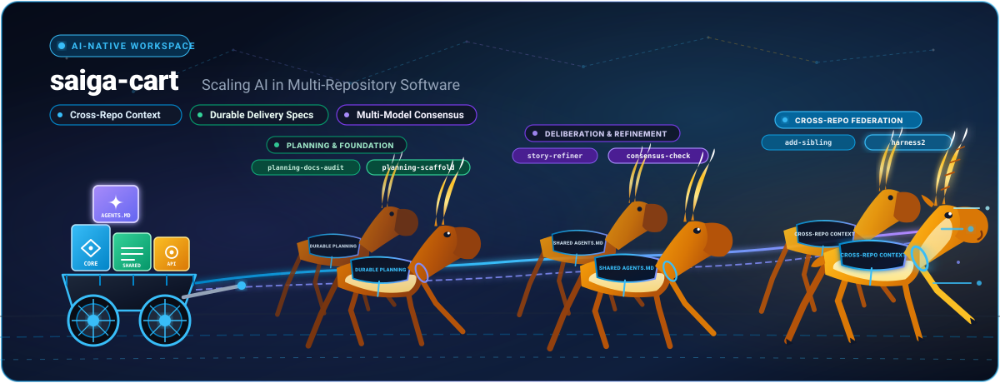

# 🛷 saiga-cart: AI-Native Multi-Repository Workspace

<p align="center">
  
</p>

[](LICENSE)
[](https://www.python.org/)
[](https://binithb.github.io/saiga-cart/)

An open-source template and interactive bootstrapper for **scaling AI development across multiple repositories**.

> 🌐 **Interactive Slide Deck & Overview**: Explore the live visual presentation and architecture walkthrough at **[https://binithb.github.io/saiga-cart/](https://binithb.github.io/saiga-cart/)**.

Named after the enduring steppe antelope (**saiga**) and the collaborative load pulling of a team (**cart**), `saiga-cart` gives AI agents (GitHub Copilot, Claude Code, Cursor, Windsurf) and software engineers durable, synchronized context across multiple related repositories and structured delivery planning.

---

## Platform Support

The generator, diagnostics, clone helper, and test suite use the Python standard
library and support **Windows, macOS, and Linux** with Python 3.8+ and Git.
Use `python` on macOS/Linux or `py -3` on Windows if `python` is unavailable.

---

## 🌟 The Two Core Capabilities

```
┌─────────────────────────────────────────────────────────────────────────┐
│                             saiga-cart Pattern                          │
├────────────────────────────────────┬────────────────────────────────────┤
│   1. Cross-Repo AI Context         │   2. Durable Delivery Planning     │
│                                    │                                    │
│   - Multi-root IDE workspace       │   - Markdown planning hierarchy    │
│   - Unified AGENTS.md directives   │   - SAFe, Scrum, Shape Up, Kanban  │
│   - Sibling repo orchestration     │   - Definition of Ready (DoR) gates│
│   - Multi-model consensus panels   │   - Bidirectional issue sync       │
└────────────────────────────────────┴────────────────────────────────────┘
```

1. **Cross-Repo AI Context**: Open multiple sibling repositories in one unified IDE session (`.code-workspace`). AI agents reason about contracts, shared models, infrastructure, and test suites simultaneously without switching windows.
2. **Durable Delivery Planning**: Keep planning context, ADRs, and story acceptance criteria versioned in markdown directly beside the codebase. This prevents settled decisions from being forgotten between AI chat sessions.

---

## 🚀 Quickstart: Bootstrapping a New Workspace

> **💡 Recommended Folder Layout**: Set up your workspace in its own **new folder** inside a shared parent directory (e.g., `~/work/my-ai-workspace`), rather than modifying your raw `saiga-cart` clone in-place. Because sibling repositories are checked out **beside** the workspace folder (`../service-a`, `../service-b`), this keeps your multi-repo parent directory clean and organized:
> ```text
> ~/work/
> ├── saiga-cart/                # Template / generator repo (stays clean)
> ├── my-ai-workspace/           # Your generated workspace (--output ../my-ai-workspace)
> ├── service-a/                 # Cloned sibling repo 1
> └── service-b/                 # Cloned sibling repo 2
> ```

Clone `saiga-cart` inside your parent workspace directory first:
```bash
mkdir -p ~/work && cd ~/work
git clone https://github.com/binithb/saiga-cart.git
cd saiga-cart
```

### Option A: Fast Preset + `/add-sibling` in AI Chat (Fastest & Easiest)
Generate your workspace in one command using a preset, then let your AI assistant inspect your repositories and configure everything automatically:

```bash
# Pick the preset matching your team's stack:
python bootstrap.py --preset github-scrum --output ../my-ai-workspace   # GitHub Issues + PRs + Scrum
python bootstrap.py --preset jira-safe    --output ../my-ai-workspace   # Jira Cloud + GitLab MRs + SAFe PIs
python bootstrap.py --preset ado-scrum    --output ../my-ai-workspace   # Azure DevOps Boards + Repos + Scrum

# Switch into your newly generated workspace before launching your AI assistant:
cd ../my-ai-workspace
```

Then open `../my-ai-workspace` in your AI assistant (GitHub Copilot CLI, Claude Code, or Cursor) and run:
```text
/add-sibling <your-git-repo-url>
```
The `add-sibling` skill verifies and clones the repository into `../<repo-name>`, inspects its tech stack and API contracts, asks you to confirm its architectural role, and automatically updates `AGENTS.md`, `docs/architecture.md`, and your issue tracker skills.

### Option B: Interactive Guided Wizard (Token Verification & Custom Topologies)
Prefer a guided terminal walkthrough that tests your API tokens (`.env.jira`, `.env.azure`, `.env.github`, `.env.gitlab`) and verifies sibling repository URLs immediately?

```bash
python bootstrap.py
# Or specify the target folder upfront:
python bootstrap.py --output ../my-ai-workspace
```

1. **Question #1** lets you pick a **Quick Preset** (`github-scrum`, `jira-safe`, `ado-scrum`) or **Custom Setup** (Scrum, SAFe, Shape Up, or Kanban).
2. Configure and live-test your tracker/VCS credentials (or skip and configure later).
3. Add sibling repository URLs right away (verified via `git ls-remote`) or skip and use `/add-sibling` later.

---

## ⏱️ Your First 5 Minutes (Day-1 AI Workflow)

Once your workspace is created (`cd ../my-ai-workspace`), follow this progression in your AI coding assistant:

| Step | What You Type in AI Chat (or Terminal) | What Happens |
|---|---|---|
| **1. Add Repos** | `/add-sibling <git-repo-url>` | Clones `../<repo>`, inspects stack/contracts, and remaps `AGENTS.md` & `docs/architecture.md`. |
| **2. Plan Epic & Stories** | `"Use planning-scaffold to create our first epic and stories in docs/planning/01/"` | Scaffolds markdown epic `plan.md`, `progress.md`, and story specs. |
| **3. Refine & Size** | `"Run story-refiner on docs/planning/01/"` | Checks Definition of Ready (DoR), surfaces open decisions via `ask_user`, and sizes stories. |
| **4. Sync to Tracker** | `"Use jira-story-onboard (or ado-work-item-onboard / github-issue-onboard) on our ready story"` | Creates the remote ticket after your confirmation, renames `<story>-<KEY>.md`, and links bidirectionally. |
| **5. Ship & Review** | `"Use pr-create to run readiness + consensus checks and open our PR/MR"` | Runs multi-model `consensus-check`, verifies DoD, and creates the PR/MR. |

---

## 📂 Repository Layout

```
saiga-cart/
├── bootstrap.py                    # Interactive setup wizard
├── AGENTS.md                       # Canonical agent directives & boundary rules
├── CLAUDE.md                       # Claude Code workspace guidelines
├── .cursorrules                    # Cursor IDE rules
├── .github/
│   ├── copilot-instructions.md     # GitHub Copilot CLI & Chat instructions
│   ├── agents/                     # Persistent custom agent definitions (/agent <name>)
│   │   ├── bootstrapper.agent.md
│   │   ├── ci-cd.agent.md
│   │   ├── test-engineer.agent.md
│   │   └── presentation-designer.agent.md
│   ├── workflows/                  # GitHub Actions multi-OS test matrix & Pages deploy
│   │   └── ci-cd.yml
│   └── skills/                     # Reusable autonomous agent procedures
│       ├── add-sibling/            # Onboard sibling repo, inspect stack & remap agent/architecture docs
│       ├── story-refiner/          # Batch story DoR audit and sizing
│       ├── planning-scaffold/      # Generates cycles/sprints/epics/stories
│       ├── planning-docs-audit/    # Validates link integrity and metadata
│       ├── consensus-check/        # Risk-scaled multi-agent deliberation
│       ├── harness2/               # Context budget validator, experience ledger & task probes
│       ├── pr-create/              # Readiness + consensus check & functional PR/MR creation
│       └── pr-reviewer/            # Interactive PR/MR review walkthrough & thread replies
├── scripts/
│   ├── clone_siblings.py           # Cross-platform sibling repository checkout
│   └── workspace_doctor.py         # Diagnostic verification utility
└── docs/
    ├── architecture.md             # Cross-repo system contracts & data flows
    ├── workflow.md                 # Working conventions, DoR/DoD, sizing rules
    ├── adr/                        # Architecture Decision Records (append-only)
    ├── ai/                         # Cross-sprint Experience Ledger (experience.md)
    ├── planning/                   # Active cycles / increments / sprints
    └── presentation/               # Self-guided HTML presentation on AI WoW
```

---

## 🛠 Supported Tooling Integrations

| Dimension | Supported Integrations |
|---|---|
| **Planning Frameworks** | Scrum (Sprints), SAFe (Program Increments), Shape Up (Cycles), Kanban (Milestones) |
| **Issue Trackers** | GitHub Issues/Projects, Jira Cloud/Server, GitLab Issues, Azure DevOps Boards, Local Markdown |
| **Version Control** | GitHub (PRs), GitLab (MRs), Azure Repos, Bitbucket |
| **AI Assistants** | GitHub Copilot CLI/Chat, Claude Code, Cursor, Windsurf, generic MCP-compatible agents |

---

## 🤖 Persistent Custom Agents

The repository includes 4 persistent custom agent definitions under `.github/agents/` that can be loaded into GitHub Copilot CLI or compliant tools via `/agent <name>`:

- **/agent `bootstrapper`**: Scaffolding, customizing, and maintaining multi-repo topologies and generators.
- **/agent `ci-cd`**: GitHub Actions multi-OS test matrix automation and GitHub Pages deployment.
- **/agent `test-engineer`**: Cross-platform unit tests, smoke matrices, and test strategy maintenance.
- **/agent `presentation-designer`**: Static presentation deck design, HTML/CSS/JS, and UI/UX documentation.

---

## 🔍 Diagnostics, E2E Tests & Local Mock Onboarding Sandbox

Run the workspace doctor anytime to verify your environment, sibling checkouts, and planning integrity:

```bash
python scripts/workspace_doctor.py
```

To test the full new-user onboarding experience locally (including live mock Jira Cloud & Azure DevOps REST servers, mock `az` CLI, and local bare sibling Git repositories):

```bash
# Run the automated unit + interactive E2E onboarding test suite
python -m unittest discover -s tests -v

# Launch the interactive local mock sandbox for hands-on Jira or ADO walkthroughs
python tests/mocks/tracker_sandbox.py --demo jira
python tests/mocks/tracker_sandbox.py --demo ado
```

---

## 📜 License

Distributed under the [MIT License](LICENSE).
